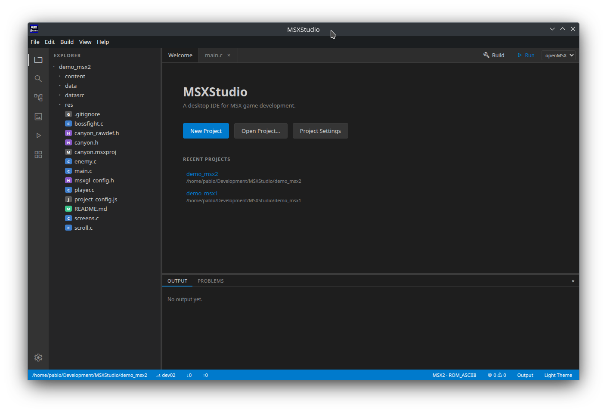
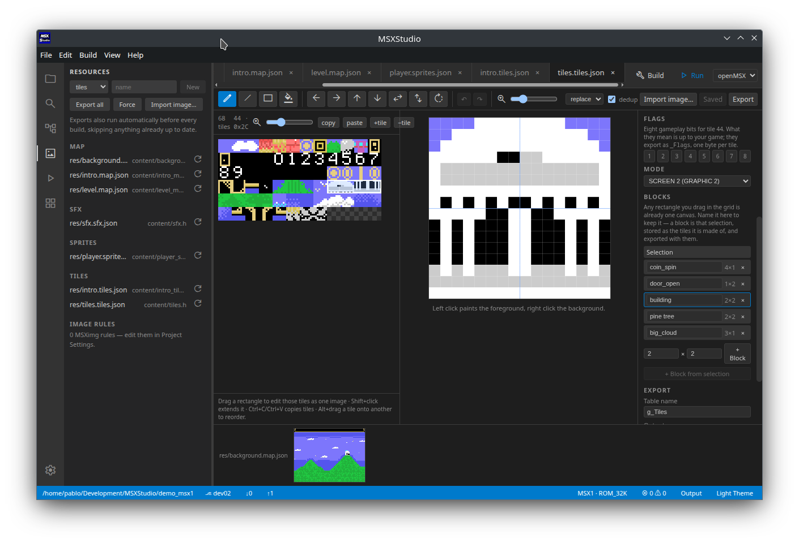
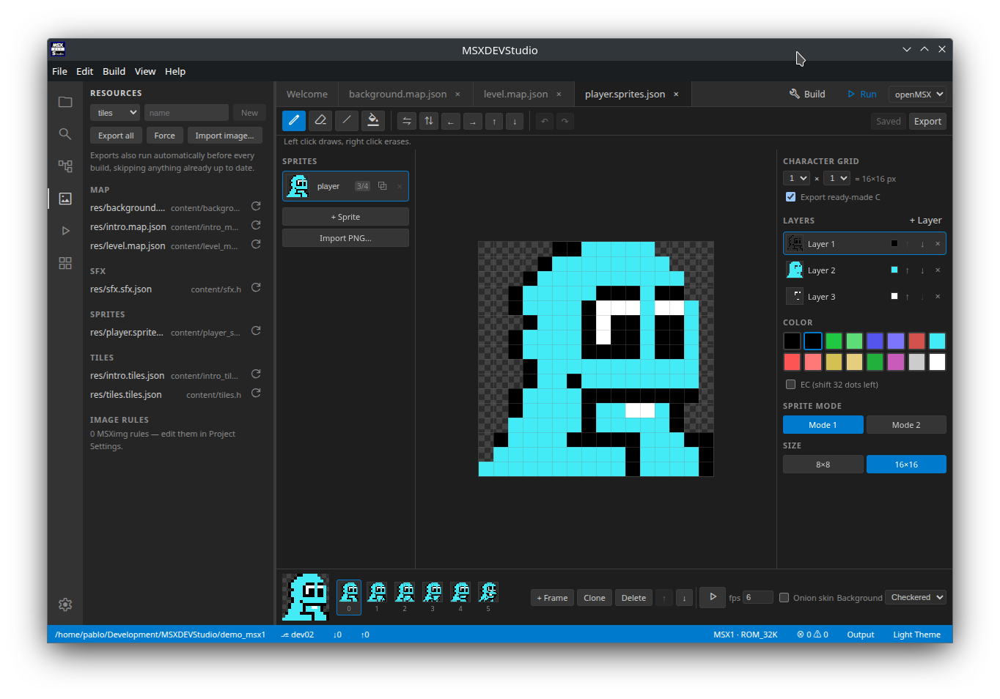
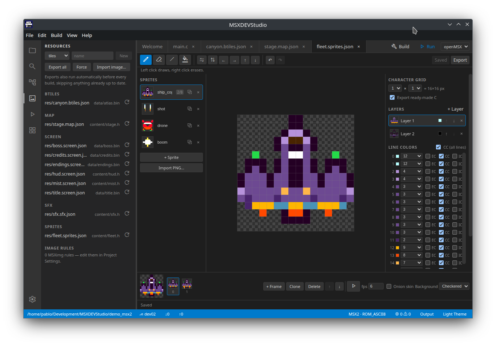
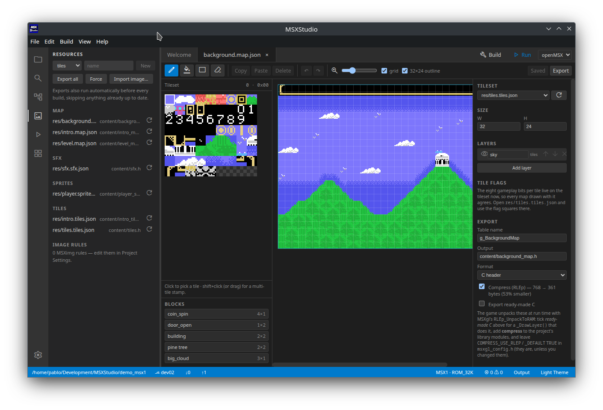
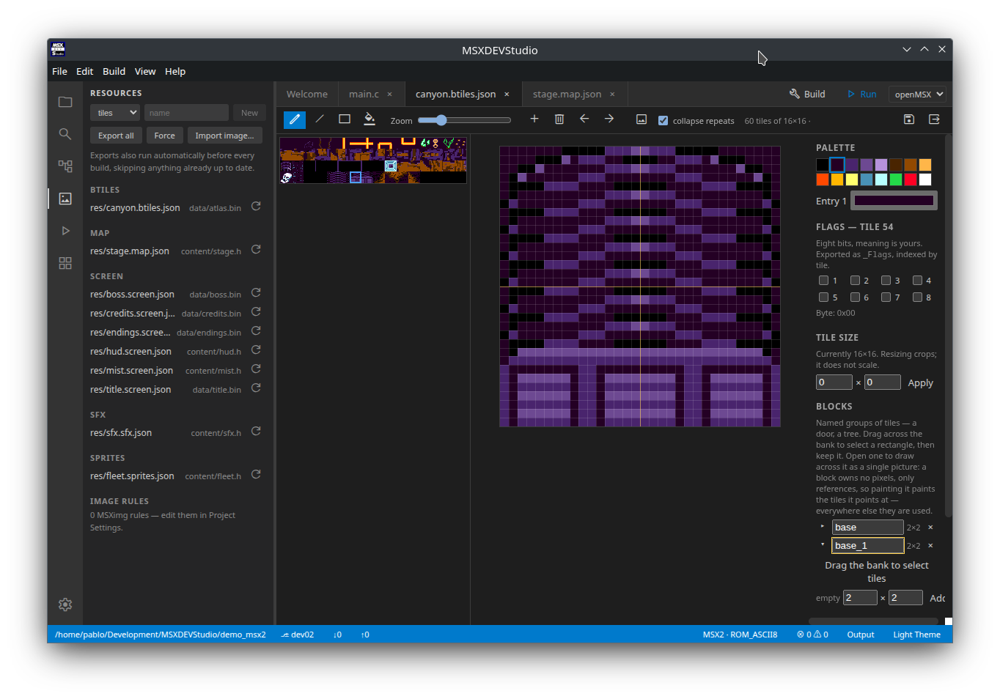
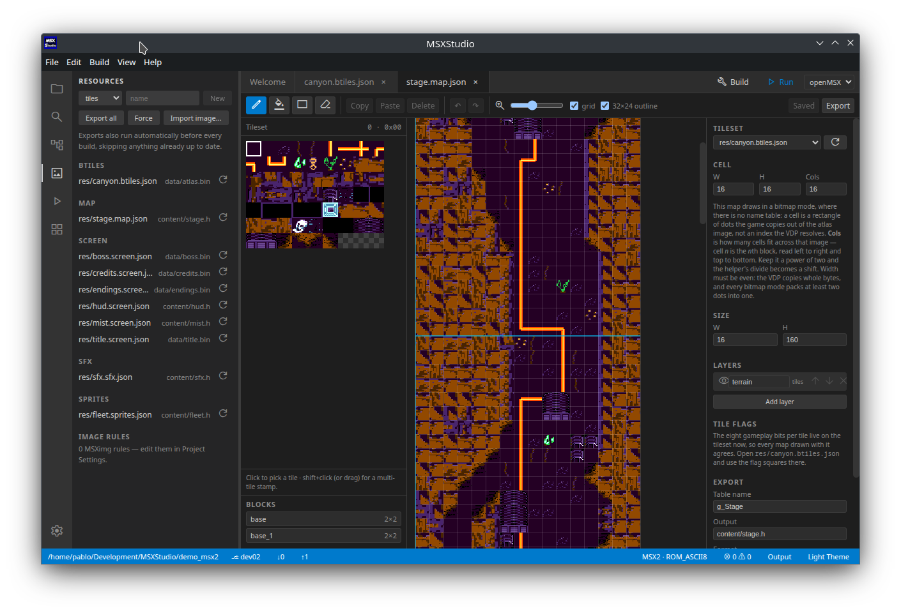

# Resources

Resources are the art and sound you make inside MSXDEVStudio. Each one is a file
in your project that an editor owns, and each one exports a C header your game
`#include`s.

| Kind | File | Editor | Use it for |
|---|---|---|---|
| tiles | `name.tiles.json` | Tile editor | 8×8 patterns for SCREEN 1/2/4 |
| bitmap tiles | `name.btiles.json` | Bitmap tile editor | Tilesets for the MSX2 bitmap modes (SCREEN 5–8) |
| meta-tiles | `name.meta-tiles.json` | Pose editor | One design bigger than a tile, with its own art, poses and flags: attached to tilesets, placed on maps |
| meta-tiles (bitmap) | `name.meta-btiles.json` | Meta-tile editor | A design bigger than a tile in a bitmap mode: drawn into one bitmap tileset, frames redrawn per copy |
| animated tile | `name.anim-tiles.json` | Animation editor | A tile (or a few) that animates — water, a coin, a torch — attached to a tileset |
| sprites | `name.sprites.json` | Sprite editor | 8×8 or 16×16 hardware sprites |
| map | `name.map.json` | Map editor | Tile layouts / levels |
| screen | `name.screen.json` | Screen editor | Full-screen MSX2 bitmaps (SCREEN 5–8) |
| sfx | `name.sfx.json` | SFX editor | ayFX sound effects |
| music | `name.music.json` | Music editor | Background music for the PSG, drawn on a piano roll |

## Creating and opening

In the **Resources** panel (side bar): pick a kind, type a name, press **New**.
The file is created in the project's **`res/`** folder and its editor opens.
Click any listed resource to reopen it later — or open the file from the
Explorer.

**New tiled screen…** (File menu, or the Resources panel) makes the pair a
SCREEN 2 picture is drawn as — `res/name.tiles.json` with tile 0 reserved
blank, and a 32×24 `res/name.map.json` over it — and opens the map in paint
mode, so the first thing you do is draw. It refuses a name either file already
carries rather than overwriting.

`res/` is where new resources go so the project root doesn't fill up with a
tileset, its maps, its sprite sheets and their sources. Nothing requires it:
the project is walked recursively, so a resource anywhere in it is still found,
listed and exported — projects made before this keep working untouched, and you
can move files into `res/` at your leisure. If you do move a tileset, fix the
**Tileset** dropdown in any map that referenced it (a map stores that path).

Exported headers are a separate thing and still go where the resource's
**Output** says, `content/` by default.



## The editors

**Tiles** — draw with pencil, line, rectangle and fill. Shift, mirror and
rotate the current tile; `+tile` and `−tile` grow and shrink the bank.
Colors depend on the mode: SCREEN 2/4 give you two colors per 8-pixel row,
SCREEN 1 gives one pair per group of 8 tiles. SCREEN 4 adds an editable
16-colour palette. The **Mode** dropdown converts between them, warning first
when the target can't hold what you have — going to SCREEN 1 keeps one pair
per group of eight and drops the rest. **Import image…** converts a PNG into a
whole tileset.

Deleting or dragging a tile renumbers the ones after it, and MSXDEVStudio rewrites
every map drawn with the tileset to match — open ones immediately, closed ones
when you next open them. The tile's flags and any block using it follow too, so
re-arranging a tileset never quietly changes what a level means.



**Tile flags** — eight numbered squares in the tile editor, in the manner of
PICO-8's sprite flags. They say what a tile *means* to your game rather than how
it looks: solid, collectable, deadly, whatever you decide. They belong to the
tileset, so every map drawn with it agrees, and they export as `_Flags`, one
byte per tile, only once some tile carries a bit.

```c
#define FLAG_SOLID 0x01          // flag 1 is bit 0
if (g_Tiles_Flags[tile] & FLAG_SOLID) { /* blocked */ }
```

That turns collision into a table lookup rather than a list of tile numbers in
your code, so re-arranging a tileset does not break the game. See
[`demo_msx1`](../demo_msx1/README.md) for it in use.

**Editing several tiles at once** — drag a rectangle in the tile grid and the
canvas shows those tiles as one image, seams drawn in blue. Nothing is copied:
you are painting the tiles themselves, across their boundaries. Shift+click
extends the rectangle from the current tile, and a plain click goes back to
editing one. (Reordering a tile is **Alt**+drag, because it renumbers the bank.)

**Tile blocks** — a door, a tree or a boss face is bigger than one tile, and
once you have drawn one you can keep it: **+ Block from selection** names the
rectangle you have selected. A block holds no pixels of its own, only references
to tiles in the same bank, so painting a block still paints those tiles — it is
the selection made permanent, and it is what the exporter writes out (see
*Blocks* under Export). **+ Block** instead appends that many blank tiles as a
new block, for starting from nothing. In SCREEN 1 a new block starts on a
colour-group boundary, because eight consecutive tiles share one FG/BG pair
there — the panel warns when a block can't own its whole group.



**Sprites** — mode 1 gives each sprite one colour; mode 2 gives a colour per
line, plus the EC/CC/IC bits. Sprites are 8×8 or 16×16 and can stack up to 4
layers for multicolour characters. The animation bar previews frames.



**Metasprites** — a character can span a grid of hardware sprites (the
*Character grid* control): 2×2 of 16×16 sprites is a 32×32 Metal Gear-style
hero that moves as one — sprites side by side rather than stacked. Click a cell
on the canvas to draw on it; a cell you emptied gets a plane back when you click
it. Each cell is a separate hardware sprite and each of its layers costs
another, so every character shows what it spends of the VDP's 4 (mode 1) or
8 (mode 2) sprites per scanline.

**Compressing a map** — a name table is mostly runs of the same tile, so the
map editor's Export block offers **Compress (RLEp)**, with the two sizes shown
next to the checkbox so the trade is visible before you take it (a screen of
sky and ground is typically 768 → under 40 bytes). RLEp is *MSXgl's own* format:
the game unpacks with `RLEp_UnpackToRAM` from the engine's `compress` module —
add that module in Project Settings, and leave `COMPRESS_USE_RLEP` and
`COMPRESS_USE_RLEP_DEFAULT` TRUE in `msxgl_config.h` (they are by default).
Tick **Export ready-made C** for a `_DrawLayer()` that unpacks and writes to
the name table in one call, and size your buffer with the generated
`..._UNPACKED_SIZE`.

A layer that packs no smaller than raw is shipped raw instead — and because one
`_DrawLayer()` serves every layer, one such layer turns compression off for the
whole map rather than leaving a helper that is wrong for one of the tables. The
generated header's parameter block always says which of the two happened.



**Map** — pick a tileset first (dropdown in the side panel), then paint with
stamp, fill, rectangle and erase. Shift+click or drag in the tile picker takes
a multi-tile stamp. A 32×24 map is exactly one screen; larger maps get a screen
outline overlay for designing scrolling worlds.

**Banks (SCREEN 2/4)** — the screen has three pattern tables, one per third
(rows 0–7, 8–15, 16–23). Under the tileset picker, **Repeat** uses one set of
256 tiles in all three thirds; **Banked** gives each third its own 256, up to
768 on screen. Switching either way repacks the 32×24 screen from what it
shows, so nothing on screen changes — Repeat is refused when the screen draws
more than one set holds. Banked, each third can be **filled from another
tileset**: pick it beside *Rows 0–7* (and so on) and its tiles are copied into
that bank, so the cells there draw its art. It is a copy, edited here from then
on; ↻ copies it again after the source changed. The map editor's zoom goes to
32 pixels a dot, for painting dot by dot.

Every **Import image…** into a SCREEN 2/4 tileset or map asks the same thing:
**Banks: Auto** (one set, banked only when the picture needs more than 256 tiles
and can be), **Repeat** (one set, never banked) or **Banked** (a set per third —
into a tileset that needs a picture exactly 192 dots tall, and replaces the whole
set).

In a **bitmap mode** a layered map needs to know which cell means "nothing",
because a cell index is an atlas position and 0 is a picture like any other. So
a layered bitmap map names its own **transparent cell** (the checkbox under
*Cell*), and the export then adds a `_DrawRowOver()` beside `_DrawRow()` that
skips that index instead of blitting it — draw the background row first, then
the overlay. Leave it off and every cell is drawn, which is what a single-layer
map wants; the Problems panel points it out if a map grows a second layer
without one.

In a **pattern mode** there is no equivalent, and that is the hardware talking:
`_DrawLayer()` writes the whole rectangle in one `VDP_WriteLayout_GM2`, so there
is no per-cell decision to hook. A foreground layer there is something you
compose yourself, row by row, before writing it — usually by giving the
see-through tile a flag and testing it as you build each row.

**Meta-tiles** — the hardware's unit is an 8×8 cell, and almost nothing in a
game is 8×8. A **meta-tile** is one design several cells across — a tree, a
door, a torch — with its own art, its own poses, the cells it leaves
see-through, and eight gameplay flag bits. One file is one meta-tile, and it
**owns its pixels**: it names no tileset, so the same tree can be used with the
level tileset and the title tileset alike.

Create one from the Resources panel (`meta-tiles`, in a tile mode) and draw it
in the pose editor — the animation editor's canvas and pose strip, any size up
to 16×16 tiles. The **see-through** tool (the hatched button) marks cells that
are never written when the meta is drawn, in any pose, so whatever is under it
shows: the only transparency a name table has. The flag squares are in the side
panel. One pose is a still meta; add poses and it animates.

**Attaching** a meta to a tileset gives it tile numbers there: in the tile
editor's **Meta-tiles** panel, or simply by placing it on a map, which attaches
it to the map's tileset. Cells that look the same in every pose become ordinary
tiles, shared with identical art already in the set; the cells that **change
between poses** get a window of their own that the tileset's `_Animate()`
rewrites, exactly like an attached animation — so every copy animates in step,
on screen or not, for nothing per copy, and a big house with a smoking chimney
only rewrites the chimney. Save the meta and every tileset it is attached to
follows: tiles that still show the right art are kept, what changed is appended,
and nothing else drawn with the tileset moves.

So a meta's tiles are **its** art, not the tileset's: the tile grid outlines
them (dashed violet, and the readout names the meta), and the tile editor
refuses to paint or delete them — an edit there would be rebuilt from the
meta's file the next time the tileset opens. Paint them in the meta-tile's own
editor; to delete them, remove the meta first. An image import that
**replaces** the whole tileset asks once and removes every attached meta first,
for the same reason; **merge** keeps them. The map editor's edit mode forks
such a tile instead of rewriting it, as it does an animation's.

**Removing** one from a tileset — the **Remove** button beside it in the tile
editor's **Meta-tiles** list, or beside the tileset in the meta-tile's own
*Attached to* list — takes it off every map drawn with that tileset too, after a
confirm naming them: a map cannot place a meta its tileset does not have. An
open map drops it as one undoable edit; a closed one is rewritten. Its tiles
stay in the tileset as art (a map's **Remove unused tiles** reclaims them), and
a baked placement leaves its cells in the grid.

To use one, open a map and pick it from the **lower half** of the left sidebar —
tiles above, meta-tiles below. Every meta-tile in the tileset's mode is offered;
a dashed one is not attached yet, and picking it attaches it. Click to place,
click a placed one to select it, drag to move, Delete to remove.

A placement is a **live reference** by default: the grid under it holds tile 0,
the game draws it from the placement table each time. Tick **Bake into the
layer** for static scenery instead — its tiles go into the grid, so the ordinary
layer write already draws it and it costs nothing at runtime. A baked animated
meta still animates: its moving cells are window tiles either way. Painting a
tile inside a baked placement drops its record, because the grid no longer holds
what the record claims.

**Indexed layers** — a map built from meta-tiles should not store every cell.
Click a layer's **tiles** label to make it **indexed**: it then holds meta-tiles
only, in any mix of sizes, and exports one byte per meta-tile instead of one per
cell — a screen of 2×2 metas is 192 bytes rather than 768. They may overlap, and
stack as placed, later on top; one that starts inside another, or that reading
order would draw underneath, costs three bytes more. The side panel says what the
layer costs. The game expands it
into a tile map in RAM (`_Expand()`, below) and draws that; animated metas keep
animating there, including the ones a scrolling view only reaches later.

**Bitmap meta-tiles** — a `.meta-btiles.json` is the bitmap-mode kind, and
works differently: it is drawn over one bitmap tileset (`.btiles.json`), holds
that tileset's tile numbers, and painting it resolves each stroke into the
tileset as you draw. Its frames are redrawn per copy, by the map's
`_DrawPlacements(frames, …)`. **Compact unused tiles** in its side panel reclaims
tiles its editing session created and no longer uses.

**Bitmap tiles** — the SCREEN 5/6/7/8 counterpart of a pattern tileset, and a
different thing from a screen. A screen is one picture used as it is; a tileset
is a bank of small images addressed by number, which a map indexes and the game
blits. It is deliberately shaped like the pattern tileset — the same tile flags,
the same named blocks, the same renumbering when you reorder — and differs only
where the hardware does:

- **Pixels, not patterns.** A pattern tile is eight pattern bytes plus colour
  attributes. A bitmap tile is one palette index per pixel, packed on export to
  whatever the mode holds — two per byte in SCREEN 5, four in SCREEN 6.
- **Any size.** A pattern tile is 8×8 because the name table says so. Nothing in
  a bitmap mode cares, so the size belongs to the tileset: 16×16 for chunky art,
  8×8 for fine, 32×16 if that is what the picture wants.
- **Cut from an image, as well as drawn.** Import a PNG and slice it into cells,
  which is what makes this usable for art made outside MSXDEVStudio.



Without it, a bitmap-mode map has to point its tileset at a picture and read it
as an implicit grid. That works, but it costs what a tileset is *for*: no
gameplay flags, so collision falls back to comparing tile numbers against
ranges; no blocks; and the tile order becomes load-bearing, because it is the
only thing carrying meaning.



The tiles are uploaded to VRAM as a grid rather than one long strip — fifty
16-dot tiles in a row would be 800 dots wide and VRAM is 256 across — and the
exported code indexes into that sheet for you.

**Screen** — for MSX2 bitmap modes only. Import a source image, then retouch
the conversion with pencil/fill and edit the palette. For MSX1 full-screen art,
draw a tileset and place it in a map instead.

**Fragments** — bitmap modes have no name table, so the block idea arrives as a
**fragment**: pick the **cut** tool (the dashed-corners icon) and drag a rectangle on the converted image to
name a cut-out of it. Fragments are bitmap-mode blocks *and* the frames of a
software sprite; like blocks they hold no pixels, so retouching the image
updates every fragment over it.

**Compressing a picture** — a SCREEN 5 image is 27 KB, so the screen editor's
Export block has the same **Compress (RLEp)** checkbox, with both sizes shown.
It packs in **bands** rather than in one piece, precisely because no 32K-ROM
program could unpack 27 KB in RAM: each band is one buffer's worth of lines
(`..._BAND_BYTES`, 2 KB — 16 lines in SCREEN 5), and the generated
`_Unpack(buffer, y)` unpacks one and blits it with `HMMC` before touching the
next, so the whole picture never has to be anywhere but VRAM. `_Bands` is the
u16 offset table it walks.

The palette and any fragment strip stay uncompressed: they are small, and the
strip is uploaded straight from ROM in one `HMMC`. As with maps, a picture that
packs no smaller than raw is shipped raw — dithering in particular defeats
run-length coding, so check the numbers next to the checkbox before assuming.

**SFX** — one file holds a bank of effects. Draw tone, noise and volume per
frame, press Play to hear it. Start from a preset, or import `.afx`/`.afb`
files from AYFX Editor. An effect's position in the list is its id, so
reordering renumbers them — which is why the header names each one
(`G_SFX_JUMP`); use those. Each effect has a **Priority**, 0 the most important:
an effect only cuts off one that matters as much or less, so give the sounds
that must be heard (a death, a level clear) a low number and the small ones (a
coin, a step) a higher one. **Channel** is the PSG channel the bank's effects
borrow from the music while they play.

**Music** — one file holds a bank of songs and the instruments they share, so a
game's title tune, stage tune and game-over jingle live together. A new bank
opens with a short demo song, so the first Play makes a sound.

- **Draw** on the piano roll: click for a note of the length in the toolbar, or
  drag along the row for any length. Drag a note to move it, its right edge to
  resize it; right-click or right-drag deletes. ↑/↓ transposes the selected note
  (Shift: an octave). Every note you draw or move plays, so you hear it.
- **Three channels**, A, B and C — the PSG's three voices. Pick the one you
  draw on in the toolbar; the other two show dimmed (click one of their notes to
  switch to it). Each channel plays one note at a time, so a note drawn inside
  another cuts it short. The speaker buttons mute a channel while you listen.
- **Instruments** come ready-made: leads, bass, pluck, chord arpeggios (how the
  PSG fakes a chord on one channel), a pad, and drums — kick, snare, hats, tom.
  The instrument picked in the toolbar is what new notes get; picking one while a
  note is selected re-voices that note.
- **Beat…** fills the current channel with a ready-made drum pattern on every
  bar: rock, disco, march, gallop, shuffle, half-time, drive, hats only. It
  replaces what that channel played — Ctrl+Z if you didn't mean it.
- **Bars, Speed, Loop bar.** A bar is sixteen rows of 16th notes; Speed is
  frames per row (the BPM is shown next to it); a looping song goes back to the
  Loop bar, so the bars before it play once, as an intro. Right-click a bar
  number on the ruler to copy that bar into the next one — the quick way to
  build a loop from one bar.
- **Space** plays from the ▼ on the ruler (click the ruler to move it) and
  stops. Edits made while it loops are heard straight away.
- **Sound effects over the music:** pick the project's `.sfx.json` bank under
  *Sound effects*, then press 1–9 while the song plays. What you hear is what the
  game does: the effect takes its channel (set in the SFX editor) over and hands
  it back when it ends, and a less important effect doesn't cut off a more
  important one. The bank you pick is saved with the music — it is the one the
  exported `_Update()` plays effects for. Channel C is the usual choice: put the
  drums there and nobody notices a hit lost to an explosion.
- **Jingles:** the party-popper button beside a song plays it once *over* the song that is
  playing — the song stops where it is and carries on when the jingle ends, as
  `g_Music_PlayJingle()` does in the game. The playhead disappears while the
  jingle plays and comes back where it left off. Any song can be a jingle; a
  short one-bar fanfare, played once, is the usual kind.
- The toolbar shows what the song costs in the ROM, in bytes and seconds. A busy
  beat costs more than a melody: the demo's 6.4 seconds come to about 1.5 KB.
- **Set up project** makes the changes music with sound effects needs —
  LibModules and three lines of `msxgl_config.h` (see below). It turns into
  *Project set up* once nothing is left to do.

## Importing a sheet

Asset packs — the PNGs sold on itch.io and the like — come as **sheets**: tiles
or animation frames on a grid, often with a margin and a gap between cells,
often drawn at 2× or 3×, often on a flat background colour rather than real
transparency. **Import sheet…** reads one of those and sends the cells you pick
to a resource. Open it from the Resources panel, or from the tile, map, pose or
sprite editor, which open it with their own file as the destination.

1. **Pick the PNG.** The importer guesses the rest from the image — the **pixel
   scale** (how many sheet pixels make one MSX dot), the **transparent colour**
   (the PNG's alpha, or the background colour its corners share), and the
   **grid**: cell size, margin and gap. Every guess is a field you can correct;
   *Guess* reads them again.
2. **Set the transparent colour** if the guess missed it: *Pick*, then click
   the background. Alpha is always honoured too. *±* allows a little noise.
3. **Pick the cells**: click one, drag over several, Shift+click to extend,
   Ctrl+click to add or remove one. They are taken in reading order, which is
   the order sheets are drawn in; empty cells are skipped unless you say
   otherwise.
4. **Choose where they go**, and check the result: the converted cells,
   animated when they are frames, with what the conversion cost.

| Into | Each cell becomes | Transparent dots |
|---|---|---|
| **Tileset** | Its 8×8 tiles, shared with any the tileset already has, and a **block** — so a 16×16 tile is one stamp on a map. A new tileset can also get a map laying the cells out as on the sheet. | Colour 0; a fully transparent tile is tile 0 when the tileset reserves it, as new ones do. |
| **Map** | The selection floats over the map like an imported picture; drag it and press Enter. Its tiles are made in the map's tileset where it lands. | See-through: the map shows. |
| **Animated tile** | A pose. The cell is the window, up to 16 tiles. | Colour 0. |
| **Meta-tile** | A pose, up to 16×16 tiles. | A tile empty in every pose is a see-through cell. |
| **Sprites** | A frame of a character; a frame bigger than a sprite is a metasprite grid. | Sprite colour 0. |
| **Bitmap tileset** (MSX2) | Its tiles at the tileset's own size — one tile when the cell is that size, a block of them when it is a multiple — shared with any the tileset already has. A new tileset takes the cell as its tile size, and can also get a bitmap map. | Index 0, the tileset's transparent colour; an empty tile is the reserved tile 0. |
| **Bitmap meta-tile** (MSX2) | A frame, its tiles found or made in the bitmap tileset it is drawn with (pick one for a new meta). | An empty tile is tile 0, never blitted. |
| **Software sprites** | A frame of a character, padded to what the mode draws: whole bytes in SCREEN 5–8, whole 8×8 cells in SCREEN 1/2/4, two blocks in SCREEN 3. | The sheet's transparent index. |
| **Screen** (MSX2) | The selection floats over the screen like an imported picture; drag it and press Enter. | See-through: the screen shows. |

A destination with a palette of its own — an MSX2 tileset, sprite sheet or
screen, a SCREEN 4 tileset — keeps every colour it already draws with exactly,
and the sheet's colours take the entries nothing uses yet, so a second sheet
never recolours the first. A new file gets **MSX1 colours** or a palette
**optimized for the sheet**; SCREEN 8 has no palette to choose.

For the animated kinds, **a file per row** (a character per row, for sprites)
turns idle, walk and jump rows into separate animations in one import, named
after the file and numbered. **Trim** cuts sprite frames to the box that holds
the content of all of them — so a 20×24 figure in 32×32 cells is a 2×2
metasprite only where it has to be — and meta-tiles to whole tiles of it.

Imported into an **existing** animated tile or meta-tile, the cells are added as
new poses — unless you tick **Replace its poses**, which is how a placeholder
gets its real art. A meta-tile then takes the cells' size (its flags, loop and
export stay); an animated tile keeps its own, because its window is what the
tilesets it is attached to have room for. Set the grid's cell size to the whole
picture to import it as a single pose.

A sprite plane has one colour: per sprite in mode 1, per line in mode 2. The
importer stacks planes for a figure drawn in several colours, up to **Max
planes**, and gives any colour past that the nearest one kept. In mode 2 it
hands out colours line by line, so a figure with six colours but never more
than two on one line costs two planes. The result says how many sprites one line
of the character crosses, against the 4 (MSX1) or 8 (MSX2) the VDP shows.

Into an existing file the import is one undo step in that file's editor, which
it opens; a new file is never written over one that exists. The dialog stays
open afterwards, so the next row of the sheet can go somewhere else.

## Exporting

Every editor has an **Export** block in its side panel:

- **name** — the C variable, e.g. `g_MyTiles`
- **out** — where to write it, e.g. `content/mytiles.h`
- **format** — `c` for a header, `bin` for raw bytes
- **Export ready-made C** — appends working code for the thing you just drew
  (see below). Off by default, because it calls into MSXgl.

Exports run automatically before every build, and skip anything already up to
date. To export by hand, use the **Export** button in the editor toolbar, or
**Export all** in the Resources panel.

A generated header defines one array per table, plus a size define:

```c
#define G_MYTILES_PATTERNS_SIZE 768
const unsigned char g_MyTiles_Patterns[] = { ... };
const unsigned char g_MyTiles_Colors[] = { ... };
```

Never edit generated headers — they are overwritten on every build.

## Using resources in code

Include the header, then load the arrays into VRAM. All examples assume
`#include "msxgl.h"` at the top of your `.c` file.

### Tiles

Exports `_Patterns`, `_Colors`, and `_Palette` on SCREEN 4.

```c
#include "content/mytiles.h"

VDP_SetMode(VDP_MODE_GRAPHIC2);            // SCREEN 2
VDP_LoadPattern_GM2(g_MyTiles_Patterns, 64, 0);  // 64 tiles, starting at tile 0
VDP_LoadColor_GM2(g_MyTiles_Colors, 64, 0);
```

`VDP_LoadPattern_GM2` mirrors the data into all three SCREEN 2 banks for you.
Pass `0` as the count to mean all 256 tiles. On SCREEN 1 there are no banks to
mirror, so write the tables directly instead:

```c
VDP_WriteVRAM(g_MyTiles_Patterns, g_ScreenPatternLow, g_ScreenPatternHigh, 64 * 8);
VDP_WriteVRAM(g_MyTiles_Colors, g_ScreenColorLow, g_ScreenColorHigh, 32);
```

### Sprites

Exports `_Patterns`, `_Colors`, and `_Palette` in mode 2.

```c
#include "content/myhero.h"

VDP_EnableSprite(TRUE);
VDP_SetSpriteFlag(VDP_SPRITE_SIZE_16);
VDP_LoadSpritePattern(g_MyHero_Patterns, 0, 4);  // 16×16 sprite = 4 patterns

// Mode 1 (MSX1): one colour per sprite
VDP_SetSpriteSM1(0, x, y, 0, COLOR_WHITE);

// Mode 2 (MSX2): colour per line, 16 bytes per sprite in _Colors
VDP_SetSpriteExMultiColor(0, x, y, 0, g_MyHero_Colors);

VDP_DisableSpritesFrom(1);                 // hide the rest
```

### Map

Exports one array per layer, named after the layer — the default layer
`background` becomes `g_MyMap_Background`. It is one byte per cell, so a 32×24
map is 768 bytes you can blit straight into the name table:

```c
#include "content/mymap.h"

VDP_WriteVRAM(g_MyMap_Background, g_ScreenLayoutLow, g_ScreenLayoutHigh, 32 * 24);
```

Load the map's tileset first, or you'll see the wrong patterns. For maps wider
than one screen, add MSXgl's `scroll` module to LibModules and pass the array
to `Scroll_Initialize((u16)g_MyMap_Background)` instead.

Collision comes from the tileset's flags rather than from the map, so the same
map data serves both the VDP and the game logic:

```c
u8 tile = g_MyMap_Background[y * 32 + x];
if (g_MyTiles_Flags[tile] & FLAG_SOLID) { /* blocked */ }
```

### Meta-tiles

A meta-tile's tile numbers belong to each tileset it is attached to, so they are
exported there, with a name per meta:

```c
#include "content/mytiles.h"

#define G_MYTILES_METAS      2
#define G_MYTILES_META_TREE  0
extern const unsigned char g_MyTiles_MetaInfo[];   // per meta: w, h, flags, offset lo, hi
extern const unsigned char g_MyTiles_MetaCells[];  // every meta's tiles; 0 is see-through
```

The meta's own header has its size and flags (`_W`, `_H`, `_FLAGS`) and, when it
animates, the poses of its moving tiles, which the tileset's `_Animate()` copies.

A map that places meta-tiles carries the tiles each one shows in the map's
tileset, so its export needs nothing else. An **indexed layer** exports as one
byte per meta-tile — in reading order, at each cell no earlier meta covers, the
meta's slot + 1, or 0 for an empty cell — beside each slot's tiles:

```c
#include "content/level.h"

extern const unsigned char g_Level_Terrain[];       // the indexed layer
extern const unsigned char g_Level_MetaInfo[];      // per slot: w, h, flags
extern const unsigned char g_Level_MetaCells[];     // per slot: its tiles; 0 is see-through
extern const unsigned char g_Level_MetaCellsAt[];   // where each slot starts, 2 bytes, low first
```

`_Expand()`, below, turns it into a tile map in RAM. The stream stays raw even
when the map's tile layers are compressed.

### Animated tiles

An animation owns its poses — they are tile bytes inside the file, not tiles in
a tileset — and is **attached** to a tileset in the tile editor's *Animations*
panel: select the tile your map cells already use, pick the animation, press
**Attach**. That tile (a window of tiles, for a bigger animation) shows the
first pose, every cell drawing it animates, and the other poses never take a
slot in the tileset. Detaching leaves the first pose there as ordinary art.

The animation exports its own tables:

```c
#define G_COINANIM_FRAMES 4
extern const unsigned char g_CoinAnim_Patterns[];   // poses end to end
extern const unsigned char g_CoinAnim_Colors[];
extern const unsigned char g_CoinAnim_Durations[];  // frames each pose is held
```

and the tileset it is attached to states where:

```c
#define G_TILES_ANIMS 1
#define G_TILES_ANIM_COIN 0
#define G_TILES_ANIM_COIN_SLOT 6
```

With **Export ready-made C** on the tileset, it plays them — see *Animated tiles*
under the ready-made C below.

Already animating by hand from a block of poses? Select the block in the tile
editor and use **Make animation**: it writes the animation file from the block
and attaches it at the tile you type.

### Screen

Exports `_Palette` (when the mode has one) and `_Data`.

```c
#include "content/title.h"

VDP_SetMode(VDP_MODE_SCREEN5);
VDP_SetPalette(g_Title_Palette + 2);       // entries 1-15: see below
VDP_WriteVRAM(g_Title_Data, g_ScreenLayoutLow, g_ScreenLayoutHigh, G_TITLE_DATA_SIZE);
```

`_Palette` holds all 16 entries, entry 0 first. MSXgl's `VDP_SetPalette()` loads
entries 1-15 unless `VDP_USE_PALETTE16` is TRUE in `msxgl_config.h` — the
template leaves it FALSE — so pass the table from entry 1, or turn that on and
pass it whole. Passed whole under the default, every colour lands one entry off.

### Sound effects and music

Both play through MSXgl's PSG register buffer, so a project needs:

- **LibModules**: `"psg"`, plus `"ayfx/ayfx_player"` for effects and
  `"vgm/lvgm_player"` for music;
- in `msxgl_config.h`: `AYFX_BUFFER` set to `AYFX_BUFFER_DEFAULT` (the template
  ships `AYFX_BUFFER_PT3`, which points ayFX at the PT3 music player's buffer,
  and the link fails with `Undefined Global _PT3_Regs`), and
  `LVGM_USE_MSXMUSIC`, `LVGM_USE_MSXAUDIO` and `LVGM_USE_SCC` set to `FALSE` (the
  template turns those on, and they need modules a PSG game doesn't link).

**Set up project** in the music editor does all of it. The
[music and sound tutorial](tutorials/11-music-and-sound.md) builds a complete
program out of everything below, step by step.

#### What the export writes

An SFX bank exports as one table plus a define per effect, named after the bank
and the effect — `G_SFX_PICKUP`, `G_SFX_EXPLOSION` — and `G_SFX_COUNT`. Use the
names: an effect's number is its place in the list, and reordering changes it.

A music bank exports one table per song, `g_Music_<Song>` (`stage clear` →
`g_Music_StageClear`), and for each song its length and loop point in frames, for
a game that wants to sync something to the music:

```c
#define G_MUSIC_THEME_FRAMES 320          // one pass, at one decode per frame
#define G_MUSIC_THEME_LOOP_FRAME 0        // where a looping song goes back to
#define G_MUSIC_THEME_SIZE 1488
extern const unsigned char g_Music_Theme[];
```

Tick **Export ready-made C** in each editor and the header also declares that
bank's player, every call commented, with an example at the top; the code itself
goes in the `.c` beside it. That is all the sound code a game needs:

```c
#include "msxgl.h"
#include "content/music.h"
#include "content/sfx.h"

g_Sfx_Init();                         // the bank, on its channel, nothing playing
g_Music_Play(g_Music_Theme, TRUE);    // TRUE: loop from the song's loop bar

if (jumped)
    g_Sfx_Play(G_SFX_JUMP);           // at the effect's own priority
if (levelDone)
    g_Music_PlayJingle(g_Music_Win);  // once, over the theme — which then carries on

// once per frame, after Halt() or in the V-blank hook:
g_Music_Update();                     // the song, the effect over it, out to the PSG
```

#### The sound-effect calls

| Call | Does |
|---|---|
| `void g_Sfx_Init()` | Sets ayFX up with the bank, on the channel chosen in the SFX editor, with nothing playing. Call it first: RAM is not cleared at boot |
| `u8 g_Sfx_Play(u8 id)` | Plays an effect at its own priority, from the next frame. Returns 0 when it plays, and 1 — playing nothing — while a more important one is sounding. Equal priority replaces |
| `u8 g_Sfx_PlayPriority(u8 id, u8 priority)` | The same at `priority` (0 the most important, 15 the least) for this one call |
| `void g_Sfx_Stop()` | Cuts the effect off; music on its channel comes back the next frame |
| `bool g_Sfx_IsPlaying()` | TRUE while an effect is sounding |
| `void g_Sfx_Update()` | Once per frame **in a game without music**: the effect, then out to the PSG |

#### The music calls

| Call | Does |
|---|---|
| `void g_Music_Play(const u8* song, bool loop)` | Starts a song from the top — also over one that is playing, fading or under a jingle (that song is dropped). With `loop`, it goes round from its loop bar for ever |
| `void g_Music_Update()` | Once per frame: the song, then the effects (when the music bank has an effects bank attached), then the PSG |
| `void g_Music_Pause()` | Silences the song — or the jingle — where it is |
| `void g_Music_Resume()` | Carries on from where `g_Music_Pause()` stopped it. After `g_Music_Stop()`, a finished fade or the end of a song played without loop there is nothing to carry on, and it does nothing: start a song with `g_Music_Play()` |
| `void g_Music_Stop()` | Ends the music for good — a jingle and the song under it alike |
| `bool g_Music_IsPlaying()` | TRUE while a song or a jingle is playing; FALSE while paused, after a song played without loop has ended, and after `_Stop()` or a fade |
| `void g_Music_FadeOut(u8 speed)` | Fades out, one volume step every `speed` frames — fifteen steps, so speed 4 is about a second at 60 Hz — then stops. A fade already running restarts |
| `void g_Music_PlayJingle(const u8* song)` | Plays a song once over the one playing, which stops where it is and carries on after it (below) |
| `bool g_Music_IsJingle()` | TRUE from `g_Music_PlayJingle()` until the jingle ends |
| `void g_Music_Decode()` | The song alone, into the PSG buffer — for a game that orders the frame itself (below) |

Call one of the two `_Update()`s per frame, never both: with music,
`g_Music_Update()` already runs the effects.

#### Jingles

A jingle is a short tune played *over* the music — a stage-clear fanfare, an item
pickup, an extra life. `g_Music_PlayJingle(song)` stops the song where it is,
plays `song` once, and the frame the jingle ends the song carries on from that
same spot, with no silent frame between them. Any song of any bank can be a
jingle; it always plays once, whatever its loop bar says.

```c
// Fire and forget: the theme comes back by itself.
if (gotKey)
    g_Music_PlayJingle(g_Music_KeyGet);

// Wait for it: the level ends when the fanfare does.
g_Music_PlayJingle(g_Music_StageClear);
while (g_Music_IsJingle())
{
    Halt();
    g_Music_Update();
}
NextLevel();
```

What the song does across a jingle depends on what it was doing:

| When the jingle starts, the song is… | When the jingle ends, it… |
|---|---|
| playing | carries on from where it stopped |
| paused (`g_Music_Pause()`) | is still paused — `g_Music_Resume()` carries it on |
| fading out | goes on fading from the step it had reached |
| stopped, ended, or never started | stays silent |

And what the other calls do while a jingle plays:

| Call during a jingle | Does |
|---|---|
| `g_Music_PlayJingle(other)` | Replaces the jingle; the song under it still comes back afterwards |
| `g_Music_Pause()` / `g_Music_Resume()` | Pause and carry on the jingle |
| `g_Music_FadeOut(speed)` | Fades the jingle, and at the end stops everything — the song under it included |
| `g_Music_Play(song, loop)` / `g_Music_Stop()` | Start a song / stop — the jingle and the song under it are both dropped |
| `g_Sfx_Play(id)` | Plays over the jingle exactly as over a song |

There is one lVGM player, so never start a jingle with `LVGM_Play()` yourself:
only the helper knows to put the song back. The music editor plays a jingle the
same way — the party-popper button beside a song plays it over the one playing.

#### What the helper does inside

lVGM writes only the PSG registers that *change*, and ayFX writes the effect's
channel into the same register buffer — so after an effect, the borrowed channel
would stay at the effect's pitch and volume until the song next touched it. The
music helper keeps a copy of the song's own registers (R#0–R#12), puts them back
before each decode and saves them again after. That is why there is one fixed
order per frame, and why you should not call `LVGM_Decode()` yourself when
effects play over the music. A game that needs its own order — something
between the song and the chip, say — calls the pieces:

```c
g_Music_Decode();   // the song's registers back, then this frame of the song
ayFX_Update();      // the effect over its channel (only with an effects bank)
PSG_Apply();        // the buffer to the chip
```

A fade lowers what goes to the chip, not the copy, so the song comes back at its
own volume. A jingle sets aside where the song is — the lVGM player's position,
loop point and wait, the register copy and the fade — and `_Decode` puts all of
it back the frame the jingle ends, then decodes the song's next frame in that
same call.

#### Without the ready-made C

The same works through MSXgl directly: `ayFX_InitBank(g_Sfx)`,
`ayFX_SetChannel(PSG_CHANNEL_C)`, `ayFX_PlayBank(G_SFX_JUMP, priority)`, and
`ayFX_Update(); PSG_Apply();` once per frame for effects; `LVGM_Play(g_Music_Theme,
TRUE)` and `LVGM_Decode(); PSG_Apply();` once per frame for music alone.

Author effects and music at the rate the game calls `_Update()`: 50 Hz for PAL,
60 Hz for NTSC. The players don't adjust — a 50 Hz song plays 20% fast on a
60 Hz machine.

## Ready-made C

Tick **Export ready-made C** in the side panel and the generated header carries
the code that drives what you drew, so you get a working object without writing
the VDP plumbing by hand. It calls into MSXgl, so include `msxgl.h` first.

**Sound effects and music** — a player for each bank: effects by name at their
own priority, songs that loop or play once, fades, pauses, and jingles played
over the music that hand it back where it was. The calls are listed under
*Sound effects and music* above:

```c
g_Sfx_Init();
g_Music_Play(g_Music_Theme, TRUE);
g_Sfx_Play(G_SFX_JUMP);
g_Music_PlayJingle(g_Music_Win);
g_Music_Update();                    // once per frame
```

**Sprite groups** — a metasprite, a stack of superposed planes, or both. The
header defines where each character starts, and one call places the whole group:

```c
g_Actors_SetMeta(0, x, y, G_ACTORS_HERO_BASE + frame * G_ACTORS_HERO_PLANES,
                 G_ACTORS_HERO_PLANES);
```

**Tile blocks** — stamps a block's tile indices into the name table. Needs
`VDP_USE_MODE_G2` or `VDP_USE_MODE_G3`:

```c
g_Scenery_DrawBlock(10, 5, G_SCENERY_DOOR_BASE, G_SCENERY_DOOR_W, G_SCENERY_DOOR_H);
```

**Meta-tiles** — a tileset with meta-tiles attached draws any of them by name,
see-through cells skipped:

```c
g_MyTiles_DrawMeta(G_MYTILES_META_TREE, 10, 5);   // top-left at tile column 10, row 5
```

(A bitmap meta-tile draws itself: `g_Rock_Draw(80, 140, 0, 212)` — frame 0 at
pixel 80,140, from the atlas parked at line 212.)

A map that places meta-tiles exports a placement table beside its layers, and
with helpers on, the runtime that walks it:

```c
g_Level_DrawLayer(g_Level_Background, 0, 0);   // the grid, one call
g_Level_DrawPlacements();                      // the live metas over it
```

An animated meta needs no redraw: `_Animate()` changes its tiles' art in place.
Baked placements are skipped — their tiles are already in the layer. A map of
bitmap meta-tiles takes the frame each slot shows, `frames[G_LEVEL_METAS]`
(zero it if it is a global), and the atlas line: `_DrawPlacements(frames, 212)`.

A map with an **indexed layer** gets the expander. Fill the buffer first — RAM
is not cleared at boot on a ROM target — then expand the layer over it and draw
the result:

```c
u8 g_Map[G_LEVEL_W * G_LEVEL_H];
u8 g_Objects[G_LEVEL_W * G_LEVEL_H];
for(u16 i = 0; i < G_LEVEL_W * G_LEVEL_H; ++i) { g_Map[i] = g_Level_Background[i]; g_Objects[i] = 0; }
g_Level_Expand(g_Level_Terrain, g_Map, g_Objects);
VDP_WriteLayout_GM2(g_Map, 0, 0, G_LEVEL_W, G_LEVEL_H);
```

Only the cells a meta draws are written, so see-through and empty cells keep
what was there — expand lower layers first, into the same buffer. Overlapping
meta-tiles land in the order they were placed. `g_Objects`,
or `NULL`, gets the slot + 1 of the meta covering each cell it draws, for
collision against the object: `g_Level_MetaInfo[(g_Objects[i] - 1) * 3 + 2]` is
its flags.

**Animated tiles** — a tileset with animations attached gets a player for all of
them. Call the reset once the tiles are in VRAM, then the step once per frame:

```c
g_Tiles_AnimReset();      // RAM is not cleared at boot; this also shows pose 0
while(1)
{
    Halt();
    g_Tiles_Animate();    // each animation at its own pace; VRAM only on a pose change
}
g_Tiles_AnimSetActive(G_TILES_ANIM_COIN, FALSE);   // pause one where it is
g_Tiles_AnimSetActive(G_TILES_ANIM_COIN, TRUE);    // …and resume it, mid-pose
g_Tiles_AnimRestart(G_TILES_ANIM_DOOR);            // one from its first pose, the rest untouched
u8 pose = g_Tiles_AnimGetFrame(G_TILES_ANIM_DOOR); // 0 … G_TILES_ANIM_DOOR_FRAMES - 1
```

`_AnimRestart()` is how a **play-once** animation plays again: once finished it
holds its last pose until restarted. `_AnimGetFrame()` lets the game time a
sound or a hitbox to a pose.

It rewrites the window's patterns, so every coin animates at once, on screen or
not, for 24 bytes a step in SCREEN 2 — and copies colours only when the poses
differ in colour. A meta-tile with more than one pose is played by the same
`_Animate()`, through the window its moving cells were given, and has an
`_ANIM_` index of its own for `_AnimSetActive`/`_AnimRestart`/`_AnimGetFrame`.

**Software sprites** (MSX2, `VDP_USE_COMMAND`) — characters drawn *into* the
screen, so the per-scanline sprite limit does not apply. The fragments are
exported as one strip; upload it once, then restore and draw each object:

```c
g_Actors_Upload(212);                 // strip parked below the visible lines
g_Actors_SwSprite hero = { 0 };       // slot 0 — one backup column per object
// every frame:
g_Actors_Restore(&hero, 212);
g_Actors_Draw(&hero, G_ACTORS_HERO_IDLE, x, y, 212);
```

Two rules the generated comments repeat: give every object its own `slot`, and
when objects can overlap, restore them all in reverse draw order before drawing
them all in order.
